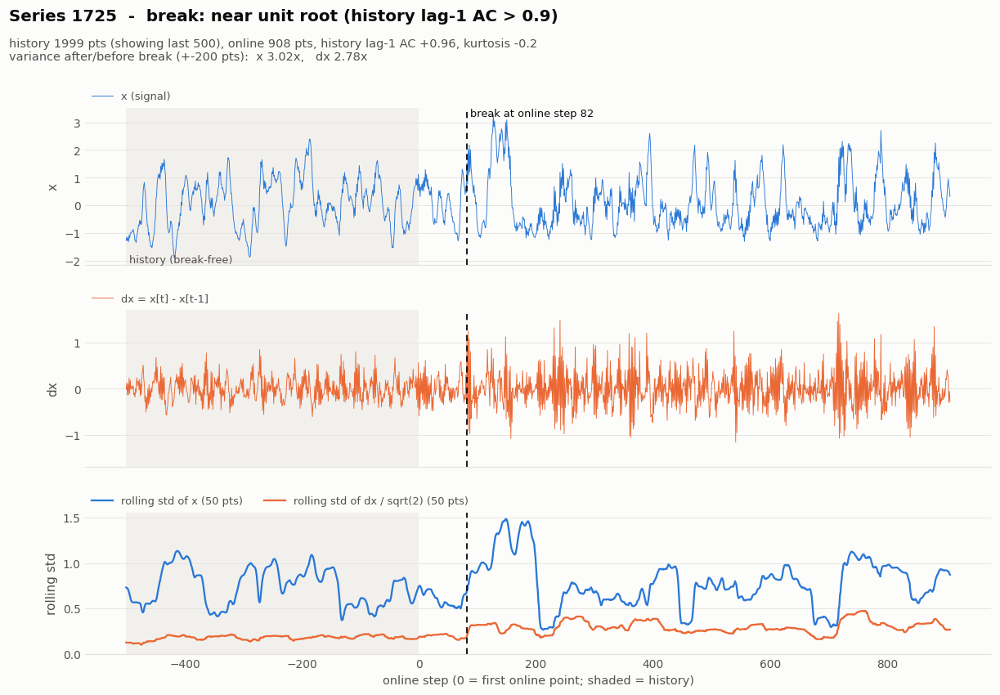

# Real-Time Structural Break Detection

My entry for the **ADIA Lab Structural Break Challenge (Real-Time Edition, CrunchDAO)**. Each series comes with a break-free history. Online points then arrive one at a time, and after each one the model must output the probability that a structural break has *already happened*. There's no look-ahead.

<p align="center"></p>

| | |
| --- | --- |
| **Metric** | TS-AUC: AUC across series at every online step, weighted by positives × negatives |
| **Data** | 10,000 series; history 1k–5k points, online 10–999 points; 50% contain one break at an unknown position |
| **Constraints** | Deterministic output (re-run tolerance 1e-8), whitelisted libraries, CPU-only cloud inference over ~5M streamed points |
| **Result** | Best CV TS-AUC **0.6534**. Cloud **0.6474** on a late practice submission, about 0.001 below the public top-50 line (0.6483) |

## What makes it hard

- **Breaks are subtle and mostly raise variance.** Mean shifts are almost absent. Even with the break position known, the best single statistic only reaches about 0.60 AUC at 300 points.
- **The no-break series are the real obstacle.** Their online variance wanders about as much as a typical break moves it. That wander turned out to be partly predictable from the end of the history, which led to volatility-state features (+0.007).
- **Data-limited.** Learning curves show roughly +0.015 per doubling of data. Real re-cuts of series helped (+0.009); synthetic breaks didn't.

## Model

A three-member blend. Each member's margin is standardised before weighting, then passed through a sigmoid.

| Member | What it is | CV alone |
| --- | --- | --- |
| **Gradient-boosted trees** | XGBoost, 2 seeds, ~320 streaming features | 0.644 |
| **GRU** | Linear → GELU → GRU(64) → MLP over 61 causal input channels, with weights averaged over epochs 5–8 | 0.642 |
| **Kernel SVM** | Least-squares SVM on 8,192 random Fourier features over the top tree features | 0.641 |

The features are all **streaming and causal**, written in numba. For every family, the streaming output was checked to match the batch computation:

- **Kernel statistics (≈270):** history-calibrated AR(1)/AR(10) residuals, ECDF and decile exceedances, variograms, long-run variances, and likelihood-ratio accumulators.
- **Bayesian online changepoint detection (BOCPD)** run-length features.
- **A "normal behaviour model" (NBM):** a GRU pretrained self-supervised on break-free histories to predict the distribution of the next AR residual. Its prediction errors become a whitened stream for BOCPD. Its log-likelihood ratios and the PCA of its **64-d hidden state** feed the other members. The hidden-state channels were the biggest single late gain (+0.004 blend).

## Research process

The work is run like an experiment log. Every idea gets a pre-declared bar, a paired 5-fold comparison against the current reference out-of-fold predictions, and an early-stop rule. It's then recorded as **ADOPTED** or **CLOSED** with the numbers. More than 40 ideas were closed this way, among them:

- TCN, CatBoost and query-attention transformer members
- DART trees and monotone constraints
- Time-reversal and sign-flip augmentation (killed by a fingerprint test that showed the augmented series were distinguishable from real ones)
- Distillation (an apparent +0.002 turned out to be leakage, caught by a leave-pair-out teacher)
- Covariate-shift weighting, test-time views, and transductive NBM adaptation

The full trail is in [`HANDOFF.md`](HANDOFF.md). The CV-to-cloud offset held steady (−0.0069, then −0.0060), so CV gains carried over to the cloud almost one for one.

## Engineering notes

- **Inference speed.** The first cloud run stalled for over 2.5 hours. The cause was 4 workers × 2 BLAS libraries × 16 threads busy-waiting. Pinning each worker to one BLAS thread with 12 workers brought it to about 1.5 ms per point, or roughly 11 minutes for the whole test set.
- `train()` caches by config hash, so re-submitting an unchanged model skips the GPU pretraining.

## Layout

```
main.py            production train()/infer() entry point
sbrt/              streaming feature kernels, NBM, BOCPD (numba)
cv.py              trees / SVM cross-validation with paired comparison
gru_cv.py          GRU member CV
blend.py           paired + honest (cross-fitted) blend evaluation
diagnostics/       gates and oracle tests for individual ideas
reports/           research summary and strategy ledger
viz/               series viewer
```

Competition data isn't included: it isn't redistributable.
